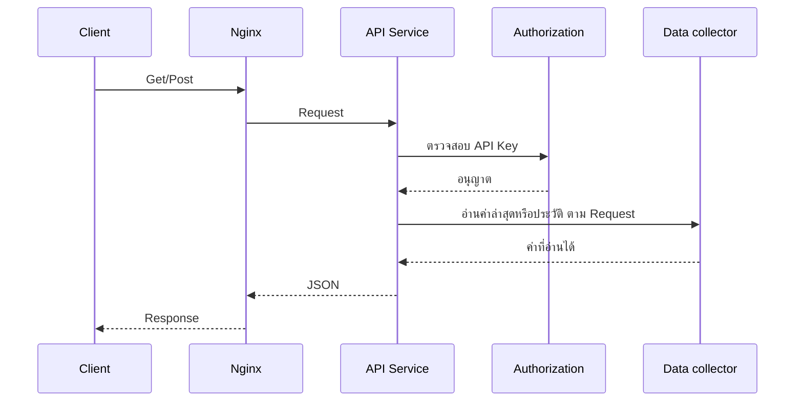

# Phase 3 — API Management

สเปกนี้ใช้หลัง checklist Phase 2 ครบ บริการอยู่ในโฟลเดอร์ `api/` และหน้าตั้งค่าอยู่ใน `frontend` เส้นทาง `site/api`

งานแยกสองที่

- โฟลเดอร์ `api/` เป็นบริการ HTTP แยกจาก PHP ให้ระบบภายนอกเรียก `/api/public/v1/` อ่านฐานข้อมูลชุดเดียวกับแอป
- แอป PHP ใน `frontend` ใช้ตั้งค่าคีย์เท่านั้น ไม่ให้บริการเส้นทาง `/api/public/v1/`

เมนู API Management เป็นของ Global ตาม `Document/php-function-plan.md` ผู้ใช้ Regional ไม่เห็นเมนูและเปิดหน้านี้ไม่ได้

ตาราง `api` เดิมเป็นลิงก์ควบคุมรายอุปกรณ์ (คีย์, ช่อง, สถานะ, MQTT) เฟสนี้ไม่แก้ ไม่ลบ และไม่ใช้ตารางนั้นเป็นตัวเรียกจากภายนอก

## สิ่งที่เฟสนี้ทำ

ผู้ใช้ Global สร้างคีย์สำหรับระบบภายนอก คีย์หนึ่งอันอ่านข้อมูลได้เฉพาะกิ่งสถานที่ที่ถูกผูก หรือทั้งระบบถ้ายกเว้นการผูกโหนด

ระบบภายนอกเรียกบริการใน `api/` และได้ JSON เท่านั้น อ่านได้อย่างเดียว ไม่สร้าง ไม่แก้ และไม่ลบข้อมูลในระบบ

## สิ่งที่เฟสนี้ไม่ทำ

- ไม่สั่งเปิดปิดอุปกรณ์ และไม่ส่ง MQTT
- ไม่แก้ผู้ใช้ สิทธิ์ รหัสผ่าน แชนเนลแจ้งเตือน หรือค่า System Setting
- ไม่ส่งออก Backup และไม่รัน Retention
- ไม่เปลี่ยนเอ็นด์พอยต์เดิมในคอนโทรลเลอร์ `Api` เช่น `getlasttele`, `devices`, `metrics`, `change`
- ไม่ให้ผู้ใช้ Regional สร้างคีย์
- ไม่ย้ายเส้นทางอ่านข้อมูลเข้าคอนโทรลเลอร์ PHP `Api`

## คีย์

เก็บในตารางใหม่ `api_clients` แบบเพิ่มอย่างเดียว ใน `Database/migrations/` รันทับฐานเวอร์ชันเดิมได้ PHP ที่ยังไม่รู้จักตารางนี้ต้องล็อกอินได้

| คอลัมน์ | ความหมาย |
|---|---|
| `id` | รหัสแถว |
| `name` | ชื่อที่ผู้ใช้ตั้ง เพื่อจำว่าระบบใดใช้คีย์นี้ |
| `token_hash` | แฮชของคีย์ เก็บค่าคีย์เต็มในฐานไม่ได้ |
| `token_prefix` | อักขระต้นของคีย์ไว้แสดงในรายการหลังสร้างแล้ว |
| `site_node_id` | โหนดที่คีย์เห็นได้ ว่างหมายถึงทั้งระบบ |
| `active` | `true` เรียกได้ `false` คือเพิกถอน |
| `expires_at` | เวลาหมดอายุ ว่างหมายถึงไม่มีวันหมดอายุ |
| `rate_limit_per_minute` | จำนวนคำขอ `node` และ `device` ที่อนุญาตต่อนาที ค่าเริ่มต้น 60 |
| `created_at` | เวลาสร้าง |
| `last_used_at` | เวลาที่เรียกสำเร็จล่าสุด ว่างได้ |
| `created_by` | `ia_users_id` ของผู้สร้าง |

ตอนสร้าง ระบบสุ่มคีย์อย่างน้อย 32 ไบต์ แล้วแสดงเต็มครั้งเดียว เก็บเฉพาะแฮชของคีย์ทั้งก้อน ผู้ใช้ปิดหน้าต่างแล้วเปิดรายการอีกครั้งเห็นได้แค่ชื่อ prefix โหนด และสถานะ การเพิกถอนตั้ง `active = false` ไม่ลบแถว Nginx และบริการ `api/` ไม่บันทึกหัวข้อ `Authorization` หรือค่าคีย์เต็มลงล็อก

คีย์ที่ผูกโหนดเห็นโหนดนั้นและลูกทุกชั้น ใช้กฎเดียวกับขอบเขต Regional ใน Site Management โหนดที่ถูกลบแล้วทำให้คีย์นั้นเรียกไม่ได้จนกว่าจะผูกใหม่หรือเพิกถอน

`expires_at` เก็บเป็นเวลาเขต `Asia/Bangkok` ถึงเวลานั้นแล้วคีย์ใช้ไม่ได้ แม้ `active` ยังเป็น `true` ค่าว่างใช้ได้จนกว่าจะเพิกถอน หน้าจัดการเปลี่ยนวันหมดอายุของคีย์ที่มีอยู่ได้ โดยไม่แสดงคีย์เต็มอีก

## หน้าจัดการ

อยู่ที่เมนู API Management ในแอป PHP เส้นทาง `site/api` หน้านี้ตั้งค่าคีย์เท่านั้น ไม่ตอบ JSON ของ `/api/public/v1/`

ผู้ใช้ที่ล็อกอินและไม่ใช่ Regional เท่านั้นที่เปิดได้

หน้ารายการแสดงชื่อ prefix โหนดหรือคำว่าทั้งระบบ สถานะ วันหมดอายุหรือคำว่าไม่มีกำหนด และเวลาใช้ล่าสุด

สร้างคีย์ได้โดยใส่ชื่อ เลือกโหนดได้หรือไม่เลือก ตั้งวันหมดอายุได้หรือเว้นว่าง และตั้งจำนวนคำขอต่อนาทีได้ ค่าเริ่มต้น 60 หลังบันทึกแสดงคีย์เต็มครั้งเดียวพร้อมปุ่มคัดลอก เปลี่ยนวันหมดอายุและจำนวนคำขอต่อนาทีของคีย์เดิมได้จากแถวนั้น หน้านี้ใช้เซสชันล็อกอินของแอป ไม่รับ API key มาสร้างหรือแก้คีย์

เพิกถอนได้จากแถวนั้น และถามยืนยันก่อน คีย์ที่เพิกถอนแล้วยังอยู่ในรายการสถานะปิด และเรียกจากภายนอกไม่ได้

## การเรียกจากภายนอก

บริการอยู่ในโฟลเดอร์ `api/` พรีฟิกซ์บนบริการนี้คือ `/api/public/v1/` ไม่ผ่าน PHP และไม่ชนเส้นทาง `/api/` ของแอปเดิม

ลำดับเมื่อเรียกสำเร็จมีห้าส่วน Client ส่งคำขอเข้า Nginx จากนั้น API Service ตรวจคีย์กับ Authorization แล้วให้อ่านค่าจาก Data collector ก่อนส่ง JSON กลับ



Nginx คือ Reverse Proxy รับคำขอแล้วส่งต่อไปบริการ `api/` Authorization ตรวจคีย์จากตาราง `api_clients` Data collector อ่าน Site อุปกรณ์ ค่าล่าสุด และ Alarm Active จากฐานข้อมูลชุดเดียวกับแอป

ถ้าตรวจคีย์ไม่ผ่านหรือพารามิเตอร์ไม่ถูก API Service ตอบ JSON ข้อผิดพลาดกลับทาง Nginx และไม่เรียก Data collector

บริการอ่านตาราง `api_clients` ที่หน้า PHP สร้างไว้ และเขียน `last_used_at` เมื่อเรียกสำเร็จ หน้า PHP ไม่เขียนคอลัมน์นี้

คำขอ `node` และ `device` ส่งหัวข้อนี้

`Authorization: Bearer <คีย์>`

`GET /api/public/v1` ไม่ใช้หัวข้อนี้

เนื้อหาตอบเป็น JSON เวลาเป็นสตริงเขต `Asia/Bangkok`

เมื่อผิดพลาด ตอบเฉพาะก้อนนี้ ไม่ปนข้อมูลธุรกิจ

```json
{ "error": { "code": "invalid_request" } }
```

## Error Code

| HTTP | error.code | ความหมาย |
|---|---|---|
| 400 | `invalid_request` | พารามิเตอร์หรือรูปแบบไม่ถูก |
| 401 | `unauthorized` | ไม่มีคีย์ หรือคีย์ใช้ไม่ได้ |
| 403 | `forbidden` | คีย์อ่านอุปกรณ์นี้ไม่ได้ |
| 404 | `not_found` | ไม่มีอุปกรณ์หรือข้อมูลนี้ |
| 405 | `method_not_allowed` | วิธี Request นี้ไม่ได้รับอนุญาต |
| 429 | `rate_limited` | เรียกเกินขีดจำกัดของคีย์ |
| 500 | `Internal server error` | API Service Error |
| 503 | `database_unavailable` | ฐานข้อมูลไม่ตอบ |

ใช้รหัสเหล่านี้กับทุกเมธอดด้านล่าง

- `400` เมื่อส่งทั้ง `zone` และ `site` พร้อมกัน เมื่อ `device` ไม่มีทั้ง `site` และ `device` หรือเมื่อค่าไอดีไม่ใช่จำนวนเต็ม
- `401` เมื่อคำขอ `node` หรือ `device` ไม่มีหัวข้อ `Authorization` คีย์ไม่ตรง ถูกเพิกถอน หมดอายุ หรือโหนดที่คีย์ผูกไว้ถูกลบแล้ว ไม่ใช้กับ `GET /api/public/v1`
- `403` เมื่อ Zone, Site หรืออุปกรณ์มีอยู่ แต่ไม่อยู่ในกิ่งที่คีย์อ่านได้
- `404` เมื่อไม่มีโหนดหรืออุปกรณ์นั้น หรือชนิดโหนดไม่ตรงกับพารามิเตอร์
- `405` เมื่อใช้เมธอดอื่นที่ไม่ใช่ `GET` บนสองทางนี้
- `429` เมื่อคำขอ `node` หรือ `device` ของคีย์นั้นเกิน `rate_limit_per_minute` ในช่วงหนึ่งนาที ค่าเริ่มต้น 60
- `500` เมื่อบริการผิดพลาดเอง `503` เมื่อติดต่อฐานข้อมูลไม่ได้

Zone ใน API นี้คือโหนดชนิด `Region` Site คือโหนดชนิด `Site` อุปกรณ์ของ Site คือแถว `devices` ที่ยังไม่ถูกลบ และ `site_node_id` เป็น Site นั้นหรือโหนดลูกของ Site นั้น

Device Info ของหนึ่งอุปกรณ์มี `id`, `name`, `serial_number`, `location`, `is_active` ไม่ส่ง `config`, `communication_config` และ `metrics`

Device Data ของหนึ่งอุปกรณ์คือค่าล่าสุดต่อ `key` จาก `device_data` แต่ละแถวมี `key`, ค่าที่ใช้จริงหนึ่งค่า และ `timestamp` ไม่ส่งประวัติทั้งตาราง

จำนวน Alarm Active นับแถว `alarm_state` ที่ `active = true` ของอุปกรณ์ในขอบเขตนั้น

### `GET /api/public/v1`

ตรวจสถานะของ API Service ไม่ต้องส่ง API key และไม่ตรวจสิทธิ์

ตอบ `200` เมื่อบริการทำงาน เป็น JSON `{"status":"ok"}` ไม่เรียก Authorization ไม่เรียก Data collector และไม่เปิดการเชื่อมต่อฐานข้อมูล คำขอนี้ไม่นับในโควตาของคีย์ Nginx จำกัดคำขอสถานะแยกตามที่อยู่ผู้เรียก ไม่เกิน 60 ครั้งต่อนาที

เมธอดอื่นที่ไม่ใช่ `GET` ตอบ `405`

### `GET /api/public/v1/node`

ดู Site ทั้งหมดที่คีย์นี้เห็นได้

แต่ละ Site มีชื่อ Zone (Region ที่เป็นบรรพบุรุษ ว่างได้ถ้า Site ไม่ได้อยู่ใต้ Region), ชื่อ Site, รายการ Device Info ของอุปกรณ์ใน Site และจำนวน Alarm Active ของ Site นั้น

### `GET /api/public/v1/node?zone=[zone_id]`

ดู Site ทั้งหมดที่อยู่ใต้ Zone นั้น และที่คีย์เห็นได้

แต่ละ Site มีชื่อ Site, รายการ Device Info และจำนวน Alarm Active ไม่ซ้ำชื่อ Zone เพราะกรองมาแล้วหนึ่ง Zone

`zone_id` ต้องเป็นโหนดชนิด `Region` ไม่มีโหนดหรือชนิดไม่ตรงตอบ `404` มีอยู่แต่นอกกิ่งของคีย์ตอบ `403`

### `GET /api/public/v1/node?site=[site_id]`

ดู Site ตาม `site_id` ที่คีย์เห็นได้

ผลลัพธ์มีชื่อ Site, รายการ Device Info และจำนวน Alarm Active ของ Site นั้น

`site_id` ต้องเป็นโหนดชนิด `Site` ไม่มีโหนดหรือชนิดไม่ตรงตอบ `404` มีอยู่แต่นอกกิ่งของคีย์ตอบ `403`

### `GET /api/public/v1/device?site=[site_id]`

ดูอุปกรณ์ทุกตัวใน Site ที่คีย์เห็นได้

ผลลัพธ์มีชื่อ Site, Device Info ทุกตัวใน Site, Device Data ของทุกตัวนั้น และจำนวน Alarm Active ของ Site พร้อมจำนวน Alarm Active แยกต่ออุปกรณ์

### `GET /api/public/v1/device?device=[device_id]`

ดูอุปกรณ์หนึ่งตัวที่คีย์เห็นได้

ผลลัพธ์มีชื่อ Site ที่อุปกรณ์สังกัด, Device Info, Device Data ของอุปกรณ์นั้น และจำนวน Alarm Active ของอุปกรณ์นั้น

อุปกรณ์ที่ไม่มีตอบ `404` อุปกรณ์ที่มีอยู่แต่นอกกิ่งของคีย์ตอบ `403`

## ความปลอดภัย

ตอนพัฒนา Nginx ส่ง `/api/public/v1/` ต่อไปบริการ `api/` ผ่าน HTTP ได้ เมื่อขึ้นใช้งานจริง Nginx รับเฉพาะ HTTPS และไม่ส่งคำขอ HTTP ต่อไป

คีย์อยู่เฉพาะในหัวข้อ `Authorization` ไม่รับคีย์ทาง query string บริการเทียบแฮชของค่าที่ส่งมากับ `token_hash` เมื่อเรียก `node` หรือ `device` สำเร็จ เขียน `last_used_at` ได้ไม่ถี่กว่าหนึ่งครั้งต่อนาทีต่อคีย์

`403` กับ `404` ใช้คนละความหมายตามตาราง Error Code ผู้เรียกที่มีคีย์ถูกต้องจึงรู้ได้ว่าไอดีนั้นมีอยู่แต่ไม่อยู่ในกิ่งของตน

การอ่านยังจำกัดที่กิ่งของคีย์ และไม่ส่ง `config`, `communication_config`, `metrics`

## การเก็บ Log

บริการ `api/` เขียนหนึ่งแถวต่อคำขอ `node` และ `device` ลงตาราง `api_request_logs` ทั้งคำขอที่สำเร็จและที่ตอบรหัสข้อผิดพลาด `GET /api/public/v1` ไม่ถูกเขียนลงตารางนี้

| คอลัมน์ | ความหมาย |
|---|---|
| `id` | รหัสแถว |
| `created_at` | เวลาที่รับคำขอ เขต `Asia/Bangkok` |
| `api_client_id` | คีย์ที่ตรวจแล้ว ว่างได้เมื่อยังไม่รู้ว่าเป็นคีย์ใด |
| `method` | เมธอด HTTP |
| `path` | ทางที่เรียก เช่น `/api/public/v1/node` |
| `zone_id` | ค่า `zone` ที่ส่งมา ว่างได้ |
| `site_id` | ค่า `site` ที่ส่งมา ว่างได้ |
| `device_id` | ค่า `device` ที่ส่งมา ว่างได้ |
| `status_code` | รหัส HTTP ที่ตอบ |
| `error_code` | ค่า `error.code` เมื่อผิดพลาด ว่างเมื่อสำเร็จ |
| `client_ip` | ที่อยู่ผู้เรียกที่ Nginx ส่งต่อมา |

ไม่เก็บหัวข้อ `Authorization` ค่าคีย์ เนื้อหาที่ตอบ และข้อมูลอุปกรณ์ในแถวนี้

แถวที่เก่ากว่า 30 วันถูกลบโดยบริการ `api/` วันละครั้ง หน้า `site/api` แสดงรายการล่าสุดของแต่ละคีย์จากตารางนี้ได้

ทุกแถวที่เขียนลง `api_request_logs` ถูกนับเพิ่มในตาราง `api_request_counts` ตามคีย์นั้น ช่วงเวลาใช้เขต `Asia/Bangkok`

| period | ความหมาย |
|---|---|
| `hour` | จำนวนคำขอในชั่วโมงนั้น |
| `day` | จำนวนคำขอในวันนั้น |
| `month` | จำนวนคำขอในเดือนนั้น |

หน้า `site/api` แสดงต่อคีย์สามจำนวนนี้ของชั่วโมงปัจจุบัน วันปัจจุบัน และเดือนปัจจุบัน ยอดชั่วโมงเก่ายกเว้น 48 ชั่วโมงล่าสุดถูกลบ ยอดวันเก็บครบเดือนปัจจุบัน และยอดเดือนเก็บย้อนหลัง 12 เดือน การลบรายละเอียดหลัง 30 วันไม่ลดยอดเหล่านี้

## สิทธิ์

การเห็นเมนูใช้ `site_menu_allowed('api')` ที่มีอยู่ ผู้ใช้ Regional ไม่เห็นเมนูนี้

การเรียก `/api/public/v1/` ไปที่บริการ `api/` ไม่ใช้เซสชันล็อกอินของหน้าเว็บ ใช้เฉพาะคีย์ รายการ Site และอุปกรณ์ถูกตัดตามกิ่งของคีย์ก่อนเสมอ

## Checklist ก่อนถือว่าเฟสนี้เสร็จ

- [ ] migration เพิ่ม `api_clients`, `api_request_logs` และ `api_request_counts` รันทับฐานเดิมได้ และผู้ใช้เดิมยังล็อกอินได้
- [ ] ผู้ใช้ Global สร้างคีย์ได้ และเห็นคีย์เต็มครั้งเดียว
- [ ] รายการหลังสร้างแสดง prefix ไม่แสดงคีย์เต็ม
- [ ] `GET /api/public/v1` ไม่ต้องส่งคีย์ ได้ `200` พร้อม `{"status":"ok"}` และไม่เปิดฐานข้อมูล
- [ ] ตอนพัฒนาเรียก `/api/public/v1/` ผ่าน HTTP ได้ และตอนใช้งานจริงคำขอ HTTP ไม่ถูกส่งต่อไปบริการ `api/`
- [ ] คีย์ถูกสุ่มอย่างน้อย 32 ไบต์ เก็บเป็นแฮช และไม่ปรากฏเต็มในล็อกหรือใน `api_request_logs`
- [ ] คำขอ `node` และ `device` ถูกบันทึกหนึ่งแถวต่อครั้ง รวมกรณี `401` `403` `404` และ `429`
- [ ] `GET /api/public/v1` ไม่ถูกเขียนลง `api_request_logs` และไม่ถูกนับใน `api_request_counts` แถวละเอียดที่เก่ากว่า 30 วันถูกลบ
- [ ] หน้า `site/api` แสดงจำนวนคำขอของแต่ละคีย์ในชั่วโมงนี้ วันนี้ และเดือนนี้
- [ ] คีย์ที่เรียก `node` หรือ `device` เกิน `rate_limit_per_minute` ได้ `429` / `rate_limited`
- [ ] ตั้งวันหมดอายุตอนสร้างได้ เว้นว่างแล้วคีย์ไม่มีวันหมดอายุ และเปลี่ยนวันหมดอายุของคีย์เดิมได้
- [ ] คีย์ที่เลย `expires_at` เรียก `GET /api/public/v1/node` ได้ `401` และ `error.code` เป็น `unauthorized`
- [ ] เพิกถอนแล้วคีย์นั้นเรียก `GET /api/public/v1/node` ได้ `401` และ `error.code` เป็น `unauthorized`
- [ ] พารามิเตอร์ไม่ถูกได้ `400` / `invalid_request` และเมธอดที่ไม่ใช่ `GET` ได้ `405` / `method_not_allowed`
- [ ] `GET /api/public/v1/node` คืนเฉพาะ Site ในกิ่งของคีย์ พร้อมชื่อ Zone, Device Info และจำนวน Alarm Active
- [ ] `GET /api/public/v1/node?zone=` คืนเฉพาะ Site ใต้ Zone นั้น Zone นอกกิ่งได้ `403` และ Zone ที่ไม่มีได้ `404`
- [ ] `GET /api/public/v1/node?site=` คืน Site นั้น Site นอกกิ่งได้ `403` และ Site ที่ไม่มีได้ `404`
- [ ] `GET /api/public/v1/device?site=` คืน Device Info และ Device Data ของทุกอุปกรณ์ใน Site พร้อมจำนวน Alarm Active
- [ ] `GET /api/public/v1/device?device=` คืน Device Info, Device Data และจำนวน Alarm Active ของอุปกรณ์นั้น
- [ ] ผู้ใช้ Regional เปิด `site/api` ไม่ได้
- [ ] เส้นทาง `/api/public/v1/` ตอบจากบริการใน `api/` ไม่ใช่จาก PHP
- [ ] หน้า `site/api` ตั้งค่าคีย์ได้อย่างเดียว ไม่มีข้อมูลอ่านของ Site หรืออุปกรณ์
- [ ] เส้นทาง `/api/getlasttele` และตาราง `api` เดิมยังทำงานแบบเดิม
