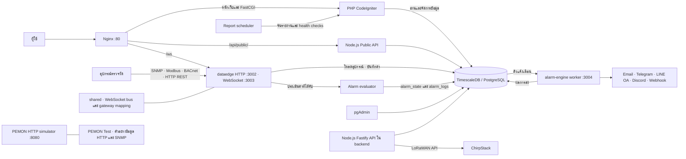

# JConnect GT7000

PHP คำนวณ Site Online จากค่าที่บันทึกในช่วง 15 นาทีล่าสุดของอุปกรณ์ที่ผูกกับ Site หรือโหนดลูก และใช้ WebSocket สำหรับอัปเดต Device Data

ตัวจำลอง PEMON ให้บริการ `GET /View1.js` ส่วนตัวอ่าน HTTP ใน dataedge ชุดนี้รองรับ metric ชนิด `rest_get` ข้อมูล PEMON ที่บันทึกไว้แล้วแสดงใน PHP ผ่าน TimescaleDB

เปิด [ER Diagram DBML](./jconnect-erd.dbml) ใน dbdiagram.io เพื่อดูตารางทั้งหมด 41 รายการและ foreign key 17 รายการจาก snapshot ของ public schema
