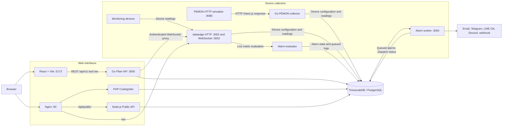
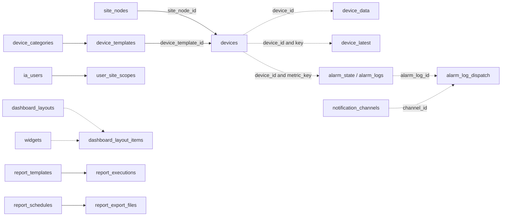

# JConnect System Diagram

React ขอค่าล่าสุดของ PEMON จาก Go API ทุก 5 วินาที ส่วน Go PEMON collector อ่านจากตัวจำลองตาม `pull_rate` และบันทึกลง `device_data` กับ `device_latest` โดยตรง เส้นทางนี้จึงแสดงค่าใน React และ PHP ได้จากฐานข้อมูล การส่งค่าผ่าน WebSocket และการประเมิน Alarm อยู่ในเส้นทางของ dataedge

PHP คำนวณ Site Online จากเวลาใน `device_data` ภายใน 15 นาที โดยใช้ค่าจากอุปกรณ์ที่ผูกกับโหนดประเภท Site หรือโหนดลูก

## Database ER Diagram

เปิด [jconnect-erd.dbml](./jconnect-erd.dbml) ใน dbdiagram.io หรือดู [ER Diagram PDF](./jconnect-erd.pdf) ไฟล์ DBML ครอบคลุม 41 รายการใน snapshot ของ public schema และแสดงความสัมพันธ์ตาม foreign key ที่ประกาศไว้ในฐานข้อมูล

เส้นประในแผนภาพย่อแสดงการอ้างอิงจากข้อมูลหรือโค้ด ส่วนเส้นทึบแสดง foreign key ใน schema snapshot
